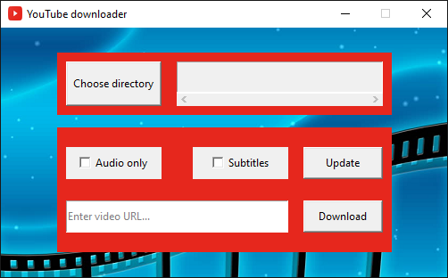

# YouTube Downloader

This program allows you to download YouTube videos, it is based on [yt-dlp](https://github.com/yt-dlp/yt-dlp). The graphical interface is made with Tkinter library.



## Prerequisites

This application requires [Python 3.8](https://www.python.org/downloads/). Check your python version using:
````
$ python --version
Python 3.8.0
````
There are no requirements for this program.

**If you don't want to install Python, just download the [release](https://github.com/Vic8t/YouTube-Downloader/releases)**.

## Quickstart

Run the program with:
```
$ uv run python -m ytdownloader
```
From the interface, choose an output directory, paste the URL of the video and press download.

**Notice: Sometimes yt-dlp is updated. If the download doesn't work, this could be the cause. In this case press update.**
